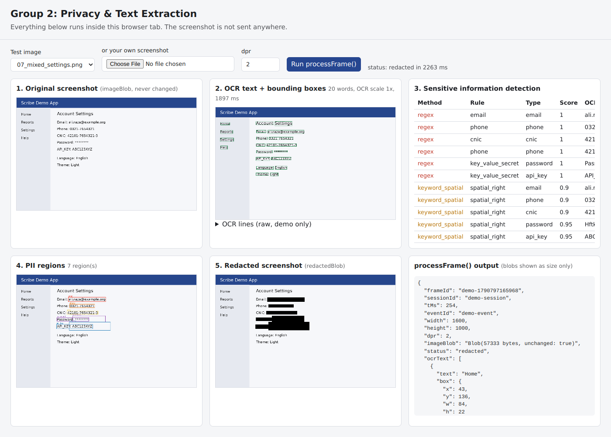

# Privacy & Text Extraction

This module takes a raw screenshot frame, reads the text on it (OCR), finds sensitive information, and returns a copy of the screenshot with that information covered by black boxes. OCR and redaction run locally. Raw screenshots are never uploaded. The AI guide writer is off by default. If the user turns it on, picks a vision provider (Groq, Mistral or Gemini) and separately consents to screenshots, the guide generator sends stored redacted screenshots and scrubbed step text to that provider. Text-only providers (Anthropic, OpenAI-compatible) receive scrubbed text only. Voice narration is also off by default; when the user turns it on and consents, the audio is sent to Groq Whisper for transcription. The Options-page connection test uses a synthetic testdata image, redacts it locally, and sends only that redactedBlob. OCR redaction can miss photos and text it cannot read.



---

## 1. Folder structure

```
<extension root>/                 (manifest.json, background.js service worker, content/, ui/)
├── group2/
│   ├── pipeline.js               processFrame(frame)  <- the required contract
│   ├── config.js                 every rule and threshold in one place
│   ├── ocr/
│   │   ├── tesseractOcr.js       local Tesseract.js worker, upscaling, timeout
│   │   └── parseTesseract.js     Tesseract result -> words/lines in screenshot pixels
│   ├── detection/
│   │   ├── regexRules.js         A. regex (email, phone, CNIC, card, IBAN, keys)
│   │   ├── keywordRules.js       B. sensitive labels (Password:, API_KEY:, CNIC:)
│   │   ├── spatialRules.js       C. value right of / below a label, password fields
│   │   ├── mlClassifier.js       D. TF-IDF + Logistic Regression in plain JS
│   │   ├── detector.js           combines A-D, merges regions, masks ocrText
│   │   └── geometry.js           box helpers
│   ├── redaction/redactor.js     Canvas masking -> new redactedBlob
│   ├── privacy/guard.js          isUploadable / assertUploadable / getUploadPayload
│   ├── offscreen/                offscreen document that hosts processFrame()
│   ├── bridge/
│   │   ├── offscreenClient.js    call from Group 1's service worker
│   │   └── blobCodec.js          Blob <-> base64 for extension messaging
│   ├── model/sensitive_model.json   trained model exported from Python
│   ├── vendor/tesseract/         Tesseract.js 5.1.1 + WASM core + English model (~11 MB)
│   ├── demo/                     visual demo (5 stages)
│   ├── tests/
│   │   ├── test.html, browserTests.js   full browser tests
│   │   └── node/                 Node tests, OCR fixtures, local CSP server
│   ├── docs/demo_screenshot.png
│   └── INTEGRATION_EXAMPLE.js    example for Group 1 (not imported anywhere)
├── ml_training/
│   ├── common.py                 text normalization + TF-IDF settings
│   ├── generate_synthetic_dataset.py
│   ├── prepare_ui_datasets.py    Screen Annotation + ENRICO -> normal UI text
│   ├── train.py                  split, train, evaluate, save, export
│   ├── export_to_js.py           sklearn model -> browser JSON
│   ├── requirements.txt
│   ├── data/                     synthetic_privacy_dataset.csv, ui_negatives.csv
│   ├── models/sensitive_classifier.joblib
│   └── reports/metrics.json, confusion_matrix.png
└── testdata/
    ├── 01_normal_ui.png ... 09_mixed_dpr1.png, 08_corrupt.png (all fake data)
    ├── cases.json                expected results for each test
    └── generate_testdata.py
```

Recorded sessions are stored in one IndexedDB database, `docTraceDB` (`storage/sessionStore.js`). Recordings from the older `scribeDB` name are copied over once on first open.

---

## 2. Where the code runs: offscreen document

Group 2 runs in an **offscreen document**. Inside it, Tesseract.js does the OCR in its own **Web Worker**.

Why not a Web Worker started from the service worker? A Manifest V3 service worker cannot create Web Workers. The offscreen document is the standard MV3 way to get a normal page context with `createImageBitmap`, `OffscreenCanvas` and Web Workers.

Flow:

```
Group 1 service worker
   |  processFrameInOffscreen(frame)          (bridge/offscreenClient.js)
   |  chrome.runtime.sendMessage  (inside Chrome only, not network)
   v
Group 2 offscreen document  -> processFrame(frame)   (pipeline.js)
   |                                   |
   |                                   +-> Tesseract Web Worker (WASM OCR)
   v
redacted frame back to the service worker (raw imageBlob is NOT sent back)
```

If a Group 1 page (popup, side panel, their own offscreen document) wants to call it directly, it can simply `import { processFrame } from './group2/pipeline.js'`.

---

## 3. Function contract

```js
import { processFrame } from './group2/pipeline.js';
const out = await processFrame(frame);
```

Input:
```js
{ frameId, sessionId, tMs, eventId, width, height, dpr, imageBlob, status: "raw" }
```

Success:
```js
{
  ...sameFrame,
  ocrText:    [{ text, box: { x, y, w, h } }],       // one entry per OCR word
  piiRegions: [{ type, box: { x, y, w, h }, source, score }],
  redactedBlob: Blob,                                // PNG
  status: "redacted"
}
```

Failure (never throws):
```js
{ ...frame, status: "failed", error: "reason" }       // no redactedBlob
```

Rules the code follows:
- `frameId`, `sessionId`, `tMs`, `eventId` and `imageBlob` are never changed. The input object is not mutated. Tests check this with a SHA-256 hash of the image bytes.
- All boxes are in real screenshot pixels. They come from the decoded image size, not CSS pixels. When the image is upscaled for OCR, boxes are divided back.
- `piiRegions` includes two extra fields, `source` (regex, keyword_spatial, ml) and `score`. They are useful for debugging and the viva.
- Words inside a PII region appear in `ocrText` as `[REDACTED:email]`, `[REDACTED:password]` and so on, so PII cannot leak into the database as text. Set `CONFIG.output.maskSensitiveOcrText = false` to turn this off.
- `processFrame(frame, { debug: true })` adds a `debug` field with raw OCR text and timings. It is for the demo page only and must never be stored.

---

## 4. Manifest entries this module needs

These lines are already in the extension's `manifest.json`:

```json
{
  "permissions": ["offscreen"],
  "content_security_policy": {
    "extension_pages": "script-src 'self' 'wasm-unsafe-eval'; object-src 'self';"
  }
}
```

- `offscreen` lets the service worker create the Group 2 offscreen document.
- `'wasm-unsafe-eval'` lets Tesseract's WebAssembly run. It does not allow remote code.

Chrome allows **only one offscreen document per extension**. This extension's offscreen document (`group2/offscreen/`) hosts the OCR pipeline, the recorder queue, voice recording and the LLM request proxy. Any new feature that needs an offscreen page should add a handler to `offscreen.js` instead of creating a second document.

Example call from the service worker: see `group2/INTEGRATION_EXAMPLE.js`.

---

## 5. Chrome Extension setup and loading (MV3)

1. Open Chrome and go to `chrome://extensions`.
2. Turn on **Developer mode** (top right).
3. Click **Load unpacked** and select the extension root folder (`secure_capture`, the one with `manifest.json`).
4. Copy the extension ID shown on the card.
5. After any code change, click the reload icon on the extension card.

No build step is needed. All files are plain ES modules.

---

## 6. Running the OCR test and the demo

### In the extension
- Demo: `chrome-extension://<EXTENSION_ID>/group2/demo/demo.html`
- Tests: `chrome-extension://<EXTENSION_ID>/group2/tests/test.html`

### Without the extension (local server)
This server has no dependencies. It sends the same CSP as MV3 extension pages, plus `connect-src 'self'`, so any outside request would be blocked.

```bash
node group2/tests/node/serveWithCsp.mjs
```
Then open:
- `http://localhost:8765/group2/demo/demo.html`
- `http://localhost:8765/group2/tests/test.html`

The demo shows the five stages side by side:

```
1. Original screenshot
2. OCR text + bounding boxes        (green boxes, raw OCR lines)
3. Sensitive information detection  (table: method, rule, type, score)
4. PII regions                      (coloured boxes by type)
5. Redacted screenshot              (redactedBlob)
```

You can choose a file from `/testdata/` or upload your own screenshot. The first run takes a few seconds while the OCR engine loads. After that, a 1600x1000 screenshot takes about 2 seconds.

---

## 7. Testing `processFrame()`

### Browser tests (full pipeline)
Open `group2/tests/test.html` (see section 6). It runs every case in `testdata/cases.json`:

| # | Case | Expected |
|---|------|----------|
| 1 | Normal screenshot | text extracted ("Dashboard", "Settings") |
| 2 | Fake email | `email` region, masked black |
| 3 | Fake phone | `phone` region |
| 4 | Fake CNIC | `cnic` region |
| 5 | `Password: ********` and a password field | `password` regions from keyword + spatial |
| 6 | `API_KEY: ABC123XYZ` | `api_key` region |
| 7 | Normal UI text | 0 regions |
| 8 | Corrupt image | `status: "failed"` |
| 9 | Mixed settings screen | all five types |
| 10 | Same screen at dpr 1 | all five types (2x OCR upscale) |

For every case it also checks:
- identity fields and `imageBlob` are unchanged (same object, same SHA-256)
- the input frame was not mutated
- the centre pixel of every PII region is black in `redactedBlob`
- boxes are inside the screenshot
- failed frames have no `redactedBlob` and are not uploadable
- the upload payload has no `imageBlob`
- the JS model gives the same scores as Python
- no page resource came from outside the browser

Last result (headless Chromium, MV3-style CSP): **14 passed, 0 failed.**

### Node tests (no browser needed)
Run all of them from the extension root (Node 21 or newer):

```bash
node --test "group2/tests/node/*.test.mjs"
```

Or one file at a time:

```bash
node group2/tests/node/mlParity.test.mjs          # JS model == Python model
node group2/tests/node/detection.test.mjs         # detection on REAL Tesseract output
node group2/tests/node/international.test.mjs     # international IDs, phones, IBANs, keys; normal UI text kept
node group2/tests/node/pipelineContract.test.mjs  # failure path, contract, privacy gate
node group2/tests/node/recorder.test.mjs          # recorder queue, text scrubber, prompt privacy guard
node group2/tests/node/capture.test.mjs           # screenshot rate limit and retries, Gemini fallbacks, Markdown export
node group2/tests/node/parallel.test.mjs          # dwell snapshot, parallel OCR queue, parallel AI groups
node group2/tests/node/gemini.test.mjs            # mocked Gemini API and image-consent behavior
node group2/tests/node/vision.test.mjs            # mocked Groq / Mistral vision API, consent, key handling
node group2/tests/node/voice.test.mjs             # narration matching, Whisper filtering, silent-mic detection
```

Last result: 10 files, 167 checks passed, 0 failed (1 dpr-1 case is skipped in Node because it needs canvas upscaling; the browser tests cover it).

`detection.test.mjs` uses saved Tesseract output in `tests/node/fixtures/`. To regenerate the fixtures after changing test images (this is a dev tool only):

```bash
npm install --no-save tesseract.js@5.1.1
node group2/tests/node/makeOcrFixtures.mjs
```

### Calling it yourself (DevTools console on the demo page)
```js
const { processFrame } = await import('/group2/pipeline.js');
const imageBlob = await (await fetch('/testdata/02_email.png')).blob();
const out = await processFrame({ frameId: 'f1', sessionId: 's1', tMs: 0, eventId: 'e1',
  width: 1600, height: 1000, dpr: 2, imageBlob, status: 'raw' });
console.log(out.status, out.piiRegions, out.ocrText);
```

---

## 8. How to verify the Gemini image privacy boundary

1. **Text-only providers.** Anthropic and OpenAI-compatible requests contain scrubbed text only. Local OCR, model, WASM and language files load from the extension or localhost.
2. **Gemini.** With Gemini selected, both text consent and separate image consent enabled, the service worker sends scrubbed context plus redacted screenshots to Google's `generateContent` endpoint. Raw screenshots are not included. Do not enable this unless you accept the provider's data terms and OCR's limitations.
3. **DevTools Network tab.** During a Gemini guide-generation request, expect a request to `generativelanguage.googleapis.com`. Inspect its payload only in a test recording with synthetic data; its `inlineData` image parts should be JPEGs created from guarded `redactedBlob` values.
4. **CSP proof.** The local demo/test server uses `connect-src 'self'`; it does not support cloud Gemini requests. Its no-external-resource test covers the OCR pipeline, not the opted-in guide generator.
5. **Code review points:**
   - `manual_generator/geminiClient.js` calls `assertUploadable()` before reading the image bytes and resizes a copy of the stored `redactedBlob`.
   - `manual_generator/manualGenerator.js` runs the existing text guard before attaching image parts to a separate Gemini request.
   - `privacy/guard.js`: `getUploadPayload()` throws for any frame that is not `"redacted"` and never includes `imageBlob`.
   - `tesseractOcr.js` sets `workerPath`, `corePath` and `langPath` to local files. Without this, Tesseract would download from a CDN.
   - `cacheMethod: 'none'` stops Tesseract from creating its own IndexedDB cache, so `docTraceDB` stays the only database.
   - `bridge/blobCodec.js` uses `chrome.runtime.sendMessage`, which is messaging inside Chrome, not the network.
6. **Chrome net log (optional).** Open `chrome://net-export`, start logging, make a synthetic recording and generate its guide, then inspect that the only upload is the opted-in Gemini request and that it contains no raw screenshot.

---

## 9. Python model training

Requirements: Python 3.9+.

```bash
cd ml_training
pip install -r requirements.txt

python generate_synthetic_dataset.py     # -> data/synthetic_privacy_dataset.csv (fake data)
python prepare_ui_datasets.py            # -> data/ui_negatives.csv (optional, needs internet once)
python train.py                          # trains, evaluates, saves, exports
```

`prepare_ui_datasets.py` options:
- `--enrico-dir PATH` reads the full ENRICO view hierarchies. Download `hierarchies.zip` from the ENRICO README, unzip it, and pass the folder. Without it, only ENRICO's sample file in the GitHub repo is used.
- `--offline` uses only files already in `data/raw/`.
- `--max 3000` sets how many UI strings to keep.

`train.py` options: `--no-ui` (synthetic data only), `--test-size 0.2`, `--threshold 0.5`.

### What train.py does
```
CSV -> normalize_text -> stratified 80/20 split -> TF-IDF (char n-grams 1-5)
    -> Logistic Regression (C=30, balanced) -> accuracy / precision / recall / F1
    -> confusion matrix -> 5-fold CV -> refit on all data -> save .joblib -> export JSON
```

Normalization: lower-case the text, replace each run of digits with a length code, and collapse spaces. For example, `35202-1234567-8` becomes `0000M-0000L-0` and `03001234567` becomes `0000X`. Without the length code, 5-character n-grams cannot tell a 6-digit count from an 11-digit phone number.

### Last training result
Dataset: 1,723 synthetic rows (590 sensitive, 1,133 normal) plus 3,000 Screen Annotation strings and 1 ENRICO sample string (all normal).

| Metric (held-out 20%) | Value |
|---|---|
| Accuracy | 0.996 |
| Precision | 0.983 |
| Recall | 0.983 |
| F1 | 0.983 |
| 5-fold CV F1 | 0.976 ± 0.012 |

Confusion matrix (rows actual, columns predicted):

|  | normal | sensitive |
|---|---|---|
| normal | 825 | 2 |
| sensitive | 2 | 116 |

These numbers are optimistic because the sensitive examples are synthetic. Real screenshots will be harder. That is why the ML model is combined with regex and label rules instead of being used alone.

### Datasets
- **Google Screen Annotation** and **ENRICO** have no privacy labels. We use only their visible UI text as realistic *normal* examples. Any string that looks sensitive (email, phone, long number, key-like token) is removed first: 1,882 strings were dropped.
- **Synthetic privacy dataset**: fake emails (`@example.com` and similar), fake PK phones, random CNIC-format numbers, public test card numbers (for example 4111 1111 1111 1111), fake passwords and API keys, and label + value pairs. A label alone ("Password", "Email:") is labelled 0, and a value or label + value is labelled 1.

---

## 10. Exporting and using the model in JavaScript

`train.py` exports automatically. To export again from a saved model:

```bash
cd ml_training
python export_to_js.py        # -> ../group2/model/sensitive_model.json (~150 KB)
```

The JSON contains the n-gram vocabulary, the IDF weights, the Logistic Regression weights and bias, the normalization settings, the metrics, and 26 "parity" rows (text plus the probability Python calculated).

`group2/detection/mlClassifier.js` repeats the exact scikit-learn math: `char_wb` n-grams, sublinear TF, IDF, L2 normalization, dot product and sigmoid. Check that it matches after every export:

```bash
node group2/tests/node/mlParity.test.mjs     # last result: max difference 4.96e-7
```

If you change `normalize_text()` in `common.py`, make the same change to `normalizeText()` in `mlClassifier.js`, then retrain and run the parity test again.

The extension never runs Python. It only reads the JSON file.

---

## 11. How detection works (and how to change it)

All four methods run, and a word is sensitive if **any** of them says so.

| Method | What it finds | File | To change |
|---|---|---|---|
| A. Regex | email, CNIC, phone (10-15 digits, any country), card (Luhn check), IBAN (PK + any country, mod-97), SWIFT/BIC with label, US SSN, UK NINO, Aadhaar (Verhoeff), Indian PAN, passport number with label, passport MRZ, `user:pass@host` URLs, AWS / Stripe-style / GitHub / GitLab / Google / OpenAI / Anthropic / Slack / SendGrid / npm / Shopify / Twilio / Mailgun keys, JWT, Bearer / Basic auth, private key headers, long random strings, `password=...` / `DB_PASSWORD=...` | `regexRules.js` | add an object to `REGEX_RULES` |
| B. Keywords | labels such as `Password`, `API_KEY:`, `CNIC:`, `Card Number` | `config.js` > `keywords` | add terms or groups |
| C. Spatial | the value to the right of a label (same row, even in another OCR line) or just below it (form fields) | `spatialRules.js`, `config.js` > `spatial` | tune distances (multiples of text height) |
| D. ML | values that no rule describes, such as `MySecret123` with no label | `mlClassifier.js`, `config.js` > `ml` | thresholds, or retrain |

Important details:
- A keyword counts as a label only if it ends with `:` or `=`, or if it is the whole line (a label above a field). So "Forgot password?", "Token expired" and "Secret Santa party" do not trigger masking.
- For **secret** labels (password, API key, card), any value next to them is masked, and the area is widened to cover the input field. If no value can be read (`********` or dots), the likely field area is masked anyway. This is fail-closed.
- For **non-secret** labels (email, phone, CNIC), the value is masked only if it looks like data (has a digit or `@`, or the ML model agrees). So an "Email" menu item next to "Settings" is not masked.
- ML is not applied to pure numbers, dates or prices. Those are handled by regex, so "Total Sales: $10000" and "12/05/2024" are never masked by ML.
- On `password=...` / `API_KEY: ...` lines, the key-value regex covers the whole line, so the label is also masked. This is on purpose (safer), and you can see it in the demo.

### Password fields
OCR cannot read masked passwords. In our test, `********` came out as `Hftkiotok` and dots came out as `eeccccccce`, both with 0% confidence. The keyword + spatial rule still finds the `Password` label and masks the field next to or below it, whatever OCR read.

---

## 12. Architecture summary (for supervisor / viva)

- **Two languages, clear split.** Python is used only offline, to train a TF-IDF + Logistic Regression classifier on fake and public UI text. The trained numbers are exported to JSON. The extension runs the same math in plain JavaScript. Python never sees a live screenshot, and there is no server.
- **Runs in an offscreen document.** MV3 service workers cannot run Web Workers or decode and draw images well. The offscreen document hosts the pipeline, and Tesseract.js runs OCR as WebAssembly in its own Web Worker. All OCR files are bundled with the extension.
- **Pipeline.** Decode the blob, then OCR words with pixel boxes, then four detectors (regex, keyword, spatial, ML) combined with OR, then merge overlapping boxes, then paint solid black rectangles on a copy with the Canvas API, and return a new `redactedBlob`. The original `imageBlob` is never changed.
- **Privacy by design.** The pipeline is fail-closed: any error gives `status: "failed"` and no redacted image, and only `"redacted"` frames pass `privacy/guard.js`. OCR text inside masked regions is replaced, so secrets do not reach the database as text. Tesseract's own cache database is turned off, so `docTraceDB` stays the only one.
- **Why these tools.** Tesseract.js is reliable in the browser and needs no training. Canvas is enough for solid masks, while OpenCV.js would add about 8 MB for no gain. TF-IDF + Logistic Regression is small (150 KB), fast (microseconds per word), explainable, and easy to export.
- **Evidence.** There are 14 automated browser tests and 167 Node checks in 10 test files (including 14 on real OCR output, 9 contract and privacy checks, 1 Python/JS parity check, and mocked tests of every AI provider and the voice pipeline). The browser tests showed 0 external network requests. The extension was also loaded unpacked in Chrome 156 and tested end to end: one-off capture, a live recording with real clicks, the Guides page, ZIP export and saving to `Downloads/DOCTrace`.

---

## 13. Implemented now vs. future work

### Implemented now
- `processFrame()` exactly matching the contract, fail-closed, sequential queue, 60-second OCR timeout
- Local Tesseract.js OCR with word boxes in screenshot pixels, PSM 11 for screenshots, and automatic 2x upscale for dpr below 1.5
- Regex, keyword, spatial and ML detection, all configurable in `config.js`
- Password field handling through label + spatial context, including unreadable fields
- Canvas redaction with solid black boxes; the original is never modified
- `ocrText` masking, the privacy gate, and an upload payload without raw pixels
- Offscreen document plus service worker bridge
- Python training, evaluation, export, and a JS parity test
- Screen Annotation and ENRICO loaders, and a synthetic fake dataset
- Demo page, browser tests, Node tests, and a local CSP test server

### Tested vs. not yet tested
- Tested: the full pipeline in headless Chromium under an MV3-style CSP, at dpr 2 and dpr 1.
- Tested as a loaded extension (Chrome 156, fresh profile): the service worker, offscreen document and `offscreenClient.js` bridge; the popup, Options, Guides and viewer pages open with no console errors; a one-off capture hid the email, phone, password and API key; a 3-click live recording gave 4 protected steps with template descriptions and no fake data in the stored text; ZIP export and the `Downloads/DOCTrace/Recording N` folder both worked.
- Not yet tested end to end: live AI providers with real API keys (covered by mocked Node tests), voice recording and Whisper transcription with a real microphone, and the Alt+Shift+S shortcut.

### Optional future work
- **Better text detection:** CRAFT or DBNet (for example through ONNX Runtime Web) to find text regions before recognition. This would help on dense or low-contrast screens.
- **PaddleOCR** (PP-OCR through ONNX / Paddle.js): often more accurate on UI text, but harder to bundle in MV3 today.
- **Input field detection** from pixels (finding rectangle borders), so password masks match the exact field edge instead of an estimate.
- **Masking low-confidence text** near labels, and a policy for screens where overall OCR confidence is very low.
- **More detectors:** names, addresses, and Urdu text (`urd` traineddata). This needs labelled data.
- **Real labelled data:** hand-label PII boxes on real screenshots, including a small set from Screen Annotation or ENRICO, to measure real precision and recall.
- **Speed:** skip OCR when a frame barely changed from the previous one, and reuse its regions.
- **Stronger model:** a small transformer (for example DistilBERT exported to ONNX) if TF-IDF is not enough.
- **OpenCV.js:** only if pixel-level operations such as field detection are added.

---

## License notes
Tesseract.js and tesseract.js-core are Apache-2.0 (licenses included in `vendor/tesseract/`). Google Screen Annotation is CC BY 4.0. Please cite ENRICO and Screen Annotation as their READMEs ask. All personal data in this project is fake.
